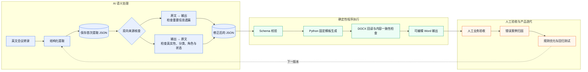

# Meeting Minutes Skill V4.1

> 将英文会议转录稳定转化为结构化、可追溯、可编辑的 Tutor 格式会议纪要——一个从 Prompt 实验走向稳定交付的 AI 产品实践。

## 核心成果概览

| 成果 | 已交付能力 |
|---|---|
| 产品落地 | 完成英文转录、AI 语义提取、结构化核查、固定模板生成到可编辑 Word 的完整闭环 |
| 真实场景验证 | 完成 **3 场真实 Scholar Hub 会议**测试，样本验收通过率 **100%（3/3）** |
| 质量保障 | 建立业务规则、双向来源核查、Schema 校验、DOCX 回读与人工验收五层机制 |
| 稳定版本交付 | 完成 **V4.1 / v4.1.0** 封装、安装、规范验证和独立调用验收 |
| 一次调用生成 | 通过 `$meeting-minutes` 一次调用完成结构化提取、核查、校验与 Tutor DOCX 生成 |

我主导定义信息收录边界、状态分类和验收标准，独立设计双向来源核查机制，并以真实错误案例驱动 V3、V4 到 V4.1 的产品迭代与稳定版本交付。

## 项目概述与需求背景

Meeting Minutes Skill 面向个人 Scholar Hub 项目，接收英文会议转录，提取 Meeting、Agenda、Open Actions、Questions for Mentor 和 Questions for Client，并使用学校 Tutor 固定模板生成可编辑 Word 纪要。

最初通过通用 AI 和多轮 Prompt 整理会议纪要，实际使用暴露了四个问题：

1. 长转录中的导师建议、客户要求和未完成事项容易遗漏。
2. 建议、计划、承诺、进行中和已完成事项容易被错误合并或升级状态。
3. Prompt 需要持续补丁式调整，难以跨会议稳定复用。
4. AI 直接生成 Word 时，字段、表格、编号和模板格式不稳定。

因此，我将产品从“单次 Prompt 生成”重构为“规则驱动的 Skill 工作流”：AI 负责语义理解，Schema 与 Python 负责确定性交付，来源核查和人工验收负责业务质量闭环。

## 核心产品设计

### 1. AI 语义理解与确定性文档生成解耦

- **AI 语义层**：识别讨论、问题、建议、要求和行动项，保留角色、条件、原因及事项状态。
- **确定性程序层**：验证 JSON，将数据写入固定 Tutor 模板，并重新打开 DOCX 逐字段检查。

该设计将内容判断与文档格式解耦，使问题可以被定位到业务规则、结构数据或生成器，而不是继续堆叠 Prompt。

### 2. 结构化输出约束机制

JSON Schema 定义 Meeting、Agenda、Open Actions 和 Questions 的数据契约，约束字段类型、固定值、空值、动态行和模板顺序。结构化中间层让 AI 输出可验证、可修正、可复用，并为 JSON–Word 一致性检查提供基准。

### 3. 业务规则驱动的质量控制

我主导定义了最影响会议纪要可信度的业务边界：

- 区分建议、要求、计划、承诺、进行中和已完成状态；
- Open Action 必须有明确动作和对象，并保留原始性质；
- 不把礼貌性回应自动视为执行承诺；
- 不把 Client / Mentor 建议改写成团队已确认决策；
- 保留有项目价值的问题，排除临时操作问题；
- 固定项目角色映射，同时独立核实实际出席者。

### 4. 双向来源核查机制

首次提取后先保存不可覆盖的基线 JSON，再重新阅读完整转录：

- **原文 → 输出**：检查重要讨论、要求、建议、问题和后续事项是否遗漏。
- **输出 → 原文**：检查真实性、角色归属、分类和事项状态。

双向核查同时控制“没有写出来”和“写出来但不准确”两类生成式 AI 风险。

### 5. 分层验收机制

业务规则和双向核查负责内容质量，Schema 与 DOCX 回读负责结构和交付一致性，人工验收负责最终业务判断。分层机制让错误可以被定位并进入下一轮规则迭代。

## 核心工作流程



## 效果评估与最终验收

评估覆盖信息完整性、内容真实性、分类准确性、事项状态、Schema 合法性，以及 DOCX 格式与内容一致性。

### 三轮真实会议测试

| 测试类型 | 测试样本 | 首次 Open Actions | 核查后 Open Actions | 人工验收 |
|---|---|---:|---:|---:|
| 真实会议回归测试 | 7 月 3 日 | **18** | **26** | **通过** |
| 真实会议回归测试 | 7 月 16 日 | **4** | **5** | **通过** |
| 独立新样本测试 | 7 月 23 日 | **4** | **4** | **通过** |
| 合计 | **3 场会议** | **26** | **35** | **100%（3/3）通过** |

核查不仅补全行动项，也修正分类和状态表达：

- 首轮发现并修正 **9 处遗漏、1 处分类问题、3 处措辞或含义问题**。
- 第二轮补充 **1 项** Mentor 后续承诺，并修正探索中方案的状态表达。
- 第三轮行动项数量不变，但补充 **1 个 Questions for Mentor**，并修正邮件验证的承诺状态。

第三轮使用未参与规则优化的新会议样本，在不修改 V4.1 核心规则、不参考历史答案的条件下独立完成。**100%** 为当前 **3 个测试样本的人工验收通过率**。

### 最终验收矩阵

| 验收项 | 结果 |
|---|---|
| 两场真实会议回归测试 | **PASS** |
| 第三场独立新样本测试 | **PASS** |
| JSON Schema 与固定字段校验 | **PASS** |
| Tutor 模板 DOCX 生成与重新打开 | **PASS** |
| JSON–DOCX 字段及动态行一致性 | **PASS** |
| 三场会议人工业务验收 | **PASS（3/3）** |
| Skill 封装、安装与 Codex 规范验证 | **PASS** |
| 新对话独立调用验收 | **PASS** |

## 版本迭代与产品复盘

| 版本 | 核心问题 | 产品决策 | 验证结果 |
|---|---|---|---|
| V3 | 候选列表可追溯，但仍存在 Question 误收、漏收和上游候选风险 | 建立候选提取、分类与对账流程，收紧问题和行动项边界 | 专项审计定位分类与语用问题，为后续规则提供错误样本 |
| V4 | 真实会议仍出现进行中事项漏收和简短回应误判 | 完整封装 Schema、生成器和模板，强化角色、状态和承诺判断 | 文档交付链路通过，回归测试继续发现规则覆盖缺口 |
| V4.1 | 单一承诺规则无法覆盖明确要求、建议、进行中任务和分阶段后续 | 扩展五类 Open Action，保存首次 JSON，引入双向来源核查 | 三轮真实会议与独立调用全部通过验收，交付稳定版本 |

## 稳定版本交付与迭代决策

V4.1 完成了规则定义、真实会议回归、独立新样本测试、人工验收、Skill 封装、安装和独立调用的完整交付闭环。经过 **三轮真实会议验证**，其中第三轮在规则保持不变的条件下通过新样本测试，我将 `v4.1.0` 确定为当前稳定使用版本。

本阶段迭代在核心流程稳定后结束。后续版本将由新场景中重复出现、影响交付质量的问题触发，避免围绕单次转录歧义继续增加规则。

## 安装与使用

运行要求：Python **3.10+**、`python-docx==1.2.0`，以及支持本地 Codex Skills 的环境。

```bash
python -m pip install -r requirements.txt
```

将仓库复制到 `~/.agents/skills/meeting-minutes/`，重新打开 Codex 对话后调用：

```text
使用 $meeting-minutes，根据这份英文会议转录生成 Tutor 格式 Meeting Minutes：<转录文件路径>
```

生成器也可在已完成 AI 提取与来源核查后单独运行：

```bash
python scripts/generate_minutes.py <meeting-json> <output-docx>
```

## 产品适用范围与后续方向

当前版本聚焦个人 Scholar Hub 项目，使用固定角色映射、项目编号和 Tutor Word 模板。后续可扩展更多会议类型与转录质量样本，建立人工标注基线，并评估内容覆盖、分类表现和人工复核成本。

Tutor 模板来自学校提供材料，当前用于个人授权场景；包含模板的仓库应保持 Private。
