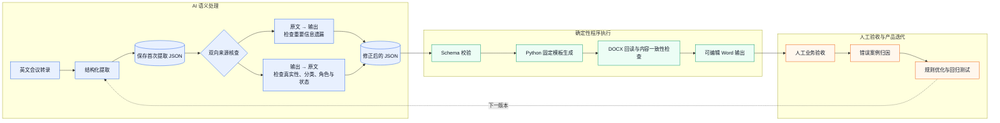
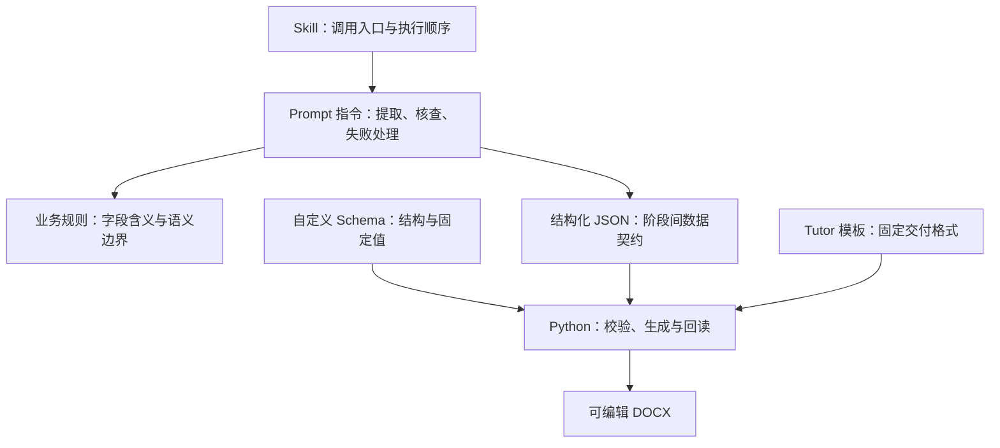

# Meeting Minutes Skill｜基于 Codex 的 AI 会议纪要自动化工具

**独立产品设计与开发 · 当前稳定版本 V4.1 / v4.1.0**

> 从英文会议转录到可编辑 Word：将一次性的 Prompt 操作，设计为可复用、可核查、可稳定交付的 AI 工作流。

## 1. 项目定位与核心成果

面向 Scholar Hub 项目中需要整理英文客户及导师会议的成员，解决长转录关键信息遗漏、建议与承诺混淆、重复调整 Prompt 及手工整理模板的问题。

**输入：英文会议转录 + 授权 Tutor 模板 → 输出：结构化 JSON + 可编辑英文 DOCX。**

我独立负责需求分析、交付与验收标准、字段映射、业务规则、AI 工作流、Python 文档生成、真实会议评测和版本交付，重点是把“能生成纪要”推进到“内容可信、格式稳定、可以持续使用”。

| 核心成果 | 项目结果 |
|---|---|
| 交付效率 | V1 单次生成约 **40 分钟**；V4.1 平均生成约 **30 秒** |
| 结构验证 | **26 项历史 DOCX 结构断言全部通过** |
| 真实场景验证 | **3 场真实会议测试与人工验收通过**，后续在 **5 场会议中实际使用** |
| 质量机制 | 业务规则、双向来源核查、Schema 校验、DOCX 回读与人工验收 |
| 稳定交付 | 完成 **V4.1** Skill 封装、安装验证与独立调用验收 |

以上为个人项目的实际使用与样本验证结果；生成耗时采用约数，不据此计算提速倍数。三场验收通过不代表模型准确率。

## 2. 产品使用效果

在 Codex 中提供英文转录并调用：

```text
使用 $meeting-minutes，根据这份英文会议转录生成 Tutor 格式 Meeting Minutes：<转录文件绝对路径>
```

工作流先提取 Meeting、Agenda、Open Actions 和 Questions，保存首次 JSON，再核查并生成 Tutor 格式 DOCX。最终文档保留可编辑表格、动态行与问题编号，便于人工复核和后续补填期限。

## 3. 需求分析与方案演进

最初的目标是从英文转录直接生成 Word。V1 单次生成约 40 分钟，内容理解与格式处理混在一次执行中，出现问题后难以判断该修改 Prompt、提取结果还是文档生成步骤。

我分析执行记录并重新定义交付标准：优先保证字段完整、内容准确与文档可编辑，不把 PDF/PNG 渲染作为每次交付的必要步骤。随后将方案拆为 AI 结构化提取、自定义 Schema 校验和 Python 模板生成，让语义判断与格式执行各自承担明确职责。

| 核心需求 | 产品验收标准 |
|---|---|
| 重要信息不遗漏、不改变原意 | 核查讨论、要求、问题、角色、条件及状态；歧义交由人工确认 |
| 固定模板稳定交付 | 保留字段、顺序、动态行与编号，DOCX 可编辑并可回读 |
| 跨会议复用 | 将 Prompt、业务规则、Schema 与工具封装为 Skill |
| 失败可定位、可恢复 | 内容错误修正 JSON；结构错误修正字段；生成失败保留数据并重试生成器 |

## 4. 核心产品设计案例

### 从“生成文件”到“定义交付”：方案选型

V1 暴露的核心问题，是语义理解、模板处理与交付检查被捆绑在同一次生成中。我将核心需求收敛为完整、准确、可编辑的会议纪要，把每次必做的视觉渲染移出主流程。以下对比是对方案取舍的产品复盘。

| 方案维度 | AI 直接生成 Word | AI + 确定性程序分层（当前方案） |
|---|---|---|
| 内容与格式 | 同一生成过程同时处理，问题相互影响 | AI 判断语义，程序执行固定模板规则 |
| 输出约束 | 主要依赖 Prompt 遵循模板 | JSON 作为数据契约，字段、固定值与空值可校验 |
| 错误定位 | 常需重新检查整份文档 | 区分内容遗漏、结构错误与生成故障 |
| 失败恢复 | 容易重复提取或反复生成 | 保留已验证 JSON，仅修正或重试出错阶段 |
| 产品代价 | 初始流程短，稳定性依赖生成表现 | 需要维护映射、Schema 和生成器，换取固定场景的可控交付 |

我选择分层方案，是因为该场景需要反复使用同一模板，稳定交付比自由排版更重要。结构化中间结果既是程序输入，也是内容核查和版本比较的基准。历史端到端测试的26项结构断言全部通过，验证了数据到文档的交付链路。

### 将模糊要求转成字段契约与分类规则

“保留重要内容”不足以指导稳定提取。我把它拆为字段收录边界、角色归属、事项状态与缺失值四组规则，并明确：**业务规则决定内容应不应该收录，Schema 决定数据是否符合交付契约。**

依据 [业务规则](references/meeting-rules.md) 与 [自定义 Schema](references/template-schema.json)：

| 字段 | 收录边界与约束 |
|---|---|
| Agenda Notes | 保存有项目意义的讨论、背景、问答、建议及状态；不能只剩行动清单 |
| Agenda Assignee | 议题汇报者，不是行动负责人；未知时使用规定占位值 |
| Open Actions | 收录明确未完成的承诺、具有后续工作的进行中事项、具体要求、待考虑建议及分阶段后续；保留原性质 |
| Questions | 团队向对应 Client/Mentor 提出的有记录价值的问题，已回答也可保留；排除音频与共享屏幕等临时操作问题 |
| 角色与出席 | 固定角色映射与实际出席分别确认；不能因 Client 缺席把 Mentor 改为 Client |
| 缺失值 | 普通必填未知值使用规定占位；时间仅由用户手动提供，否则标记待填；空问题数组生成编号 None |
| 行动责任与期限 | 不增加执行负责人，Deadline 留空供人工填写 |


#### 行动项的判断顺序

先检查是否有明确动作、对象及未完成的后续，再判断性质；不通过改写补出原文没有的任务，也不把“有用的建议”自动升级为团队承诺。

| 性质 | 判断依据 | 预期处理 |
|---|---|---|
| 团队承诺 | 团队明确表示执行具体事项 | 收录 Open Action，保留承诺性质 |
| Client / Mentor 要求 | 对方提出具体、未完成的要求 | 可收录，不需要伪造团队接受 |
| 改进建议 | 具体建议需要后续考虑 | 使用“考虑……”等表达，不写成决定 |
| 分阶段计划 | 计划包含明确后续动作 | 保留阶段及计划性质，不升级为已确认决策 |
| 进行中 | 原文明确剩余、继续或下一步工作 | 仅提取有依据的后续，不能因“尚未完成”自动收录 |
| 已完成 | 工作在会前或会中已完成 | 保留在 Agenda Notes，不列为未完成行动 |

以下为依据业务规则整理的**抽象规则示例，不是真实会议逐字引用**：

| 输入情境 | 判断依据 | 预期输出 |
|---|---|---|
| 导师建议考虑改进某项提示，团队仅表示理解 | 建议具体，但礼貌回应不等于承诺 | “考虑改进该提示”，保留建议性质 |
| 一句话同时报告功能已完成、集成仍需继续 | 同一发言含两种工作状态 | Notes 保留完成情况；Open Action 只记录继续集成 |
| 团队向导师询问项目验收要求，并当场获得回答 | 有独立项目记录价值，已回答不影响收录 | Questions for Mentor 保留问题，Notes 保留问答背景 |
| 标题写 Client Meeting，但材料仅确认导师参加 | 会议标题不是出席证据 | 保持固定角色，不将导师重分类为客户 |

### 从候选对账到双向核查：定位上游遗漏

分阶段测试将提取拆为“候选生成 → JSON 分类 → 对账”。一次实验对35个候选逐项对账，没有发现候选范围内的遗漏，却定位到议题汇报者归属错误：候选阶段保留了正确发言信息，错误发生在分类成 JSON 时。这使修正对象从笼统的“模型表现不好”收敛为具体处理阶段。

但候选对账仍有盲区：**第一阶段没有提取的内容，不会出现在后续对账范围内。** 随后的独立来源审计重新阅读原文，发现4处未进入候选集的表达；这些表达最终不一定构成行动项，但证明了“候选对账通过”不能保证完整覆盖原文。

因此，我在 V4.1 将核查基准从候选列表扩大到完整转录：

| 核查方向 | 解决的问题 | 设计动作 |
|---|---|---|
| 原文 → 输出 | 上游漏收、复合事项被摘要合并 | 保存首次 JSON 后重读完整转录，逐段检查独立事项是否覆盖或合理排除 |
| 输出 → 原文 | 无依据补写、归属错误、建议变承诺 | 将每条输出回查相关完整对话，核对分类、条件、性质与状态 |

首次 JSON 保持不变，修正结果另存，才能观察核查实际改变了什么。三场真实会议的行动项合计由26项变为35项；第三场数量不变却发现问题遗漏与状态偏差，进一步说明评测需要检查语义，而非只对数量。

### Bad Case：从错误现象到可执行修正

以下均为已有测试发现的**去标识、抽象化复盘**；输入与输出采用语义概述，不展示真实会议逐字内容。

| 案例与输入语义 | 错误输出 / 现象 | 定位与根因分析 | 规则或流程调整 | 修正结果 |
|---|---|---|---|---|
| 重要行动遗漏：导师明确承诺会后与客户讨论某项数据处理问题 | 首次 JSON 未收录该后续 | 原文有明确动作与对象，但首次提取漏收；仅回查已有输出无法发现 | 重读完整原文，逐段检查未完成后续；保留承诺者性质 | 第二场补入1项导师承诺，行动项4→5 |
| 建议与承诺混淆：团队表示某验证功能可能在后续阶段考虑，导师认为有必要 | 写成直接实施指令 | 将必要性评价及 tentative plan 压缩成确认承诺 | 核对完整交流，区分建议、计划与承诺；不以认可或必要性替代接受证据 | 第三场改为“考虑实施”，保留阶段不确定性 |
| 问题分类错误：团队表示可以解释某技术方案 | 被改写为“客户是否愿意听解释”的问题 | 把条件式讲解提议转换成原文未充分支持的问句 | 核对提问意图及预期答复者；V4.1 再以独立记录价值排除临时互动 | 排除无依据的问题，讨论背景按需留在 Notes |
| 事项状态失真：团队仍在探索呈现方式并继续开发筛选 | 措辞可能暗示重设计已决定 | 摘要丢失探索及进行中限定，改变决策成熟度 | 检查同一事项跨字段状态一致性，保留原有限定 | 第二场恢复探索与持续开发状态 |

问题分类的专项测试还发现：输出与参考数量同为8条，仍存在一条误收与一条漏收相抵的情况。我据此将分类评测落到逐项语义对应，随后以“独立项目记录价值”重新界定问题边界，而不是把所有问句都当作产品需求。

### 从样本修正到稳定交付

我将内容质量与文档质量分开验收：前者检查遗漏、分类和状态，后者检查字段、动态行与数据一致性。两场回归后保持 V4.1 核心规则不变，使用未参与规则优化的第三场会议验证，再完成安装和独立调用。停止迭代的依据是核心交付链路与新样本均通过，而非继续为每句转录增加规则。

## 5. AI 工作流架构



### 各阶段的输入、产物与失败处理

| 阶段 / 责任 | 输入与处理 | 输出 | 失败处理 |
|---|---|---|---|
| 提取 / AI | 完整转录 + 字段及业务规则，识别角色、事项与状态 | 首次 JSON 基线 | 出席或身份不明且影响分类时向用户确认 |
| 来源核查 / AI | 完整原文与首次 JSON，双向逐项对照 | 修正后的最终 JSON | 仅修正受影响内容并重核，保持首次文件不变 |
| 结构校验 / 程序 | 按自定义 Schema 检查字段、类型、固定值与空值 | 可供生成的合法数据 | 返回字段错误，修正后重验，不重新提取无关内容 |
| 模板生成 / Python | 合法 JSON + Tutor 模板 | 可编辑 DOCX | 保留已验证数据，重试生成或报告错误 |
| 回读 / 程序 | 重新打开 DOCX，对照最终 JSON | 字段与动态行一致性结果 | 定位生成问题，修复后再交付 |
| 业务验收 / 人工 | 原文、最终内容与异常说明 | 业务确认及 Bad Case | 歧义人工判断；重复问题进入规则迭代 |

### Skill 如何组织规则与工具



结构化数据让内容修改不必重做排版，也让程序能够逐字段比较输入与最终文档。Prompt 定义处理动作，业务规则定义语义边界，Schema 定义结构契约，工具脚本执行格式约束，Skill 将它们封装为可重复调用的流程。

AI 负责语义提取和双向来源判断；程序负责自定义 Schema 校验、固定模板生成与 JSON–DOCX 一致性检查；人工负责歧义确认和业务验收。AI 来源核查不是独立的程序化事实验证。

## 6. 效果评测与版本迭代

### 产品验证体系

| 验证层 | 测试设计 | 验收重点 / 结果 |
|---|---|---|
| 最小样本 | 小规模 Agenda、行动项及问题组合 | 验证字段写入、动态行、编号及空问题显示 |
| 边界场景 | 空表、多问题、长文本与换行 | 检查模板结构及特殊输入处理 |
| 端到端 | 转录 → JSON → DOCX → 回读 | 历史样本26项结构断言全部通过，包含逐行内容对照 |
| 业务回归 | 两场真实会议，保留首次与核查后结果 | 对照原文检查遗漏、分类、角色与状态，人工验收通过 |
| 独立新样本 | 第三场会议，不参考历史答案、不改核心规则 | 检验跨会议复用，人工验收通过 |
| 交付验证 | Skill 安装及新对话独立调用 | 完成 V4.1 稳定版本交付，后续五场实际使用 |

### 三场真实会议测试

| 测试类型 | 测试样本 | 首次 Open Actions | 核查后 Open Actions | 人工验收 |
|---|---|---:|---:|---|
| 真实会议回归 | 7 月 3 日 | **18** | **26** | 通过 |
| 真实会议回归 | 7 月 16 日 | **4** | **5** | 通过 |
| 独立新样本 | 7 月 23 日 | **4** | **4** | 通过 |
| 合计 | **3 场** | **26** | **35** | **3/3 通过** |

- **第一场**：修正 9 处遗漏、1 处分类问题及3处措辞或含义问题；遗漏包括行动内容与 Agenda 议题，行动项净增8项。
- **第二场**：补充1项 Mentor 后续承诺，将可能暗示已决定重新设计的表述改为探索与持续开发状态。
- **第三场**：补充1个 Questions for Mentor，将邮件验证从实施指令修正为考虑事项，保留计划的不确定性。

第三场未参考历史答案，且未修改 V4.1 核心规则。**3/3 是样本人工验收结果，26项是历史样本的结构断言结果**；两者都不等同于内容准确率或信息召回率。行动项数量变化用于呈现核查效果，不作为召回率计算依据。

### 版本演进

| 版本 | 发现的问题与定位 | 产品决策与修改 | 验证方式与结果 |
|---|---|---|---|
| V1 | 直接生成 Word，单次约40分钟，内容与格式处理耦合 | 重新定义交付标准，向结构化提取与程序生成演进 | 形成可分层检查的交付方案 |
| V2 | 行动遗漏、问题及角色分类偏差、摘要含义改变 | 收紧字段语义和承诺边界 | 专项回归通过；当时行动收录范围较窄 |
| V3 | 问题误收漏收，候选集本身仍有遗漏 | 引入候选分类、对账和独立来源审计 | 定位上游漏收及措辞问题，沉淀规则样本 |
| V4 | 进行中事项漏收、简短回应误判，规则覆盖仍有缺口 | 完整封装 Schema、生成器与模板，强化角色和状态判断 | 文档链路通过，真实会议回归继续暴露业务缺口 |
| V4.1 | 单一承诺标准无法覆盖要求、建议及明确后续 | 扩展五类行动项，保留首次 JSON，引入双向来源核查 | 三场测试与人工验收通过，完成安装及独立调用，确定稳定版本 |

我在核心流程稳定、两场回归与第三场新样本通过后结束本阶段迭代，避免为单次转录歧义持续增加规则。后续重点是扩展会议样本并建立人工标注基线，进一步衡量内容覆盖与复核成本。

## 7. 安装与使用

运行要求：Python **3.10+**、`python-docx==1.2.0`，以及支持本地 Codex Skills 的环境。

```bash
python -m pip install -r requirements.txt
```

将仓库复制到 `~/.agents/skills/meeting-minutes/`，重新打开 Codex 对话后调用：

```text
使用 $meeting-minutes，根据这份英文会议转录生成 Tutor 格式 Meeting Minutes：<转录文件路径>
```

生成器也可在已完成 AI 提取与来源核查后单独运行：

```bash
python scripts/generate_minutes.py <meeting-json> <output-docx>
```


## 8. 产品适用范围

当前版本服务于个人 Scholar Hub 项目，使用固定角色映射、项目编号和学校 Tutor 模板；迁移到其他会议场景需要重新定义映射、规则与验收样本。它是已实际使用的个人工具，尚未商业化或开展大规模应用。

会议歧义、角色不明及状态不确定仍需人工确认。学校模板及真实会议内容仅在授权范围内使用，未经许可不公开转录、客户资料、模板或生成文档。
